# 🚀 Jakariya AI Studio (v2.0.0)

<div align="center">


-brightgreen?style=for-the-badge&logo=pytest&logoColor=white)


**The Ultimate Desktop AI Workstation, Autonomous ReAct Agent & Live Voice Ecosystem**  
*Designed & Developed by **Md. Jakariya Sheikh***

[Key Features](#-executive-overview-for-clients--buyers) • [Architecture](#-system-architecture--engineering-specs) • [Installation](#-quick-start--installation-guide) • [Agent & Smart Docs](#-autonomous-react-agent--smart-document-suite) • [Voice & Live Mode](#-live-conversation-mode--speech-stack) • [Testing](#-testing--quality-assurance) • [Build & Packaging](#-production-build--installer-generation)

</div>

---

## 💼 Executive Overview (For Clients & Buyers)

**Jakariya AI Studio** is an enterprise-grade, all-in-one desktop AI workstation designed to eliminate vendor lock-in, maximize productivity, and guarantee total data privacy. Built with high-performance Python and PySide6 (Qt6), it brings together **16 premier cloud and local AI engines**, a dynamic capability-driven Provider Registry, ultra-fast offline models, autonomous multi-turn ReAct agent capabilities, real-time web intelligence, continuous hands-free voice conversations with voice cloning, FLUX.1 ultra-HD image generation, and professional 8-format document publishing into a unified, privacy-first Windows application.

### Why Choose Jakariya AI Studio?

| Business Value | How Jakariya AI Studio Delivers |
| :--- | :--- |
| **No Vendor Lock-In** | Seamlessly connects to **16 premier AI cloud & local engines**: **Google AI Studio (Gemini 3.8 Flash, 3.6 Flash, 3.5 Flash, Flash Latest, 2.5 Pro)**, **Groq (300+ tokens/sec: GPT-OSS 120B/20B, Qwen 3.8 27B)**, **DeepSeek (R1 Reasoning & V3 via OpenRouter)**, **Anthropic Claude (3.7 & 3.5)**, **Cerebras Wafer-Scale**, **Mistral AI**, **Plugsky AI (Lite, Micro, Pro, Reasoning, DeepSeek Pro)**, **Ollama (100% Offline)**, **Cartesia AI (Sonic)**, **Fish Audio (s2.1-pro)**, **ElevenLabs**, **Hugging Face FLUX.1**, **Stability AI**, **Tavily AI Search**, and **LlamaParse**. |
| **Dynamic Capability Registry** | Built-in `ProviderRegistry` cataloging dynamic functional capabilities (`supports_chat`, `supports_reasoning`, `supports_coding`, `supports_vision`, `supports_image_generation`, `supports_stt`, `supports_tts`, `supports_web_search`) with automated health checks, dynamic model discovery, and failover routing. |
| **Enterprise Data Privacy & Security** | All conversations, message histories, credentials, and attachments stay strictly on the user's computer. SQLite configured in WAL mode (`%LOCALAPPDATA%\Jakariya AI Studio\`). Sensitive API keys are secured via **Windows Credential Manager (Keyring)**—never stored in plaintext. |
| **Zero Mandatory Recurring Fees** | Integrated with free, high-quality cloud services out of the box: **Microsoft Edge Neural TTS (Free natural conversational voices)**, **Google Web Speech STT (Free)**, **Pollinations AI (Free image generation)**, and **Ollama (Free local AI)**. Premium API keys are completely optional. |
| **Hands-Free Live Voice & Voice Cloning** | Features **Continuous Live Mode (⚡ Live)**: speak naturally with the AI like a human assistant. Features active **Barge-In interruption**, dynamic speaker echo attenuation (`0.15`), personal cloned voice IDs, and sub-second responses via Cartesia AI Sonic, Fish Audio, Edge Neural TTS (`en-US-JennyNeural`, `bn-BD-NabanitaNeural`), ElevenLabs, and Google TTS. |
| **Full Bilingual Support** | Native, fluent bilingual interaction in **Bangla (বাংলা)** and **English**, complete with embedded Bengali typography (`NotoSansBengali`) for reports and UI widgets. |
| **Smart Document Publishing** | Automatically turns AI research into stylized physical files (**PDF**, **Word DOCX**, **Excel XLSX**, **HTML**, **Markdown**, **TXT**, **CSV**, **JSON**) with Claude Desktop-style interactive preview cards and 6 color palettes. |
| **Ultra-HD Image Studio** | Built-in **FLUX.1-schnell** (via Hugging Face distributed inference), Stability AI SDXL, Pollinations AI, and an offline **Dual-Frequency Separation** portrait enhancer upscaling images 2X locally. |

---

## 🌟 Core Feature Highlights

### 🤖 1. Multi-Provider AI Engine & Central Capability Registry
* **Central Provider & Capability Registry (`ProviderRegistry`)**: System-wide model metadata container managing base URLs, live model catalogs, and granular functional capabilities (`supports_chat`, `supports_reasoning`, `supports_coding`, `supports_vision`, `supports_image_generation`, `supports_stt`, `supports_tts`, `supports_web_search`).
* **Google AI Studio**: Full support for **Gemini 3.8 Flash (Latest)**, **Gemini 3.6 Flash (High Reasoning)**, **Gemini 3.5 Flash**, **Gemini Flash Latest**, and **Gemini 2.5 Pro**.
* **Groq Ultra-Fast Inference**: Ultra-low latency LLM generation at **300+ tokens per second** (OpenAI GPT-OSS 120B & 20B, Qwen 3.8 27B, Llama 3.3 70B).
* **OpenRouter Multi-Gateway**: Universal access to DeepSeek R1, DeepSeek V3, Claude 3.5 Sonnet, GPT-4o, and Qwen 2.5 72B.
* **Anthropic Direct**: Native streaming client for Claude 3.7 Sonnet, Claude 3.5 Sonnet, and Claude 3.5 Haiku.
* **Cerebras Wafer-Scale Engine**: High-throughput reasoning workloads with wafer-scale chip speed.
* **Plugsky AI Suite**: Full native support for Plugsky Lite, Micro, Pro, Reasoning, and DeepSeek Pro.
* **Mistral AI Direct**: Native support for Mistral Large, Mistral Small, Codestral, and Pixtral vision models.
* **Ollama (100% Offline & Private)**: Zero-internet private execution (Llama 3.1/3.2, Qwen 2.5, DeepSeek Coder V2).
* **Intelligent Failover Dispatcher**: Continuously tracks endpoint health, latency, HTTP 429 rate limits, and quota balance, rerouting queries to user-prioritized backup models seamlessly.

### 🧠 2. Autonomous ReAct Agent & Sandboxed Tools
* **ReAct Reasoning & Planning Loop**: Multi-turn planning, action dispatch, observation analysis, and transparent final answer synthesis. Supports complex multi-step workflows with real-time thought streaming.
* **12 Built-in Autonomous Agent Tools**:
  1. `read_file`: Secure file reader supporting multi-encoding UTF-8/fallback for text, logs, scripts, and documents.
  2. `write_file`: Path-validated safe file creator and document generator within user-approved workspace directories.
  3. `list_directory`: Workspace explorer with glob pattern matching and directory tree navigation.
  4. `search_files`: High-speed regex and textual search across workspace files.
  5. `edit_file`: Surgical target-and-replace code editor with exact string matching and safety checks.
  6. `run_command`: Controlled system shell execution with configurable timeouts and output capping.
  7. `python_interpreter`: AST-secured in-process & sub-process Python REPL. Safe standard modules (`math`, `re`, `json`, `datetime`, `statistics`, `csv`) enabled out-of-the-box.
  8. `web_search`: Live real-time internet intelligence via Tavily AI Search, Brave Search, and DuckDuckGo fallback.
  9. `export_document`: Multi-color document publishing tool for PDF, DOCX, XLSX, HTML, and Markdown.
  10. `code_outline`: High-level symbol analyzer extracting classes, functions, methods, and docstrings from source code.
  11. `check_diagnostics`: AST linter and syntax diagnostics checker providing instant error detection.
  12. `git_tool`: Version control inspector providing git status, diff, log, commit, and branch analysis.
* **⚡ 1-Click "Allow All (Auto Run)" Permission Flow**:
  - Interactive security modal (`ToolApprovalDialog`) with 3 granular choices:
    - **`Deny Action`**: Immediately rejects or aborts the requested tool call.
    - **`Allow Once`**: Grants permission for the current single step; subsequent sensitive calls will prompt again.
    - **`⚡ Allow All (Auto Run)`**: Grants task-wide authorization for the entire ongoing ReAct planning cycle. The agent works continuously and autonomously without popping repetitive permission boxes.
  - Automatically resets permissions back to safe prompting when the task finishes or is cancelled, ensuring zero accidental permissions.
* **Strict Security Sandbox & AST Guard**: Isolated child process execution, memory safeguards, 8-second execution timeouts, AST security inspection preventing unauthorized file or system access, and prompt injection defense.
* **Temporal Real-Time Clock**: Injects live system clocks (Local Machine Time & Bangladesh Standard Time - BST / UTC+6) into prompts for pinpoint accuracy on time-sensitive queries.
* **Document Intelligence**: Deep document analysis powered by LlamaParse and native PDF extractors.
* **Secure File I/O**: Reads and writes documents safely within dedicated user directories (`Desktop`, `Documents`, `Downloads`).

### 🎙️ 3. Continuous Live Voice Mode & Natural Speech
* **Hands-Free Live Conversation (⚡ Live)**: Continuous multi-turn dialogue loop with automatic Voice Activity Detection (VAD) and configurable silence detection (500–5000ms).
* **Barge-In Interruption**: Interrupt the AI mid-sentence simply by speaking. The audio player immediately stops speaking and transitions back to listening without UI lag.
* **Acoustic Feedback Shield**: Automatically attenuates microphone gain to **0.15** during TTS playback to eliminate audio loopbacks.
* **Personal Cloned Voices**: Full support for personal cloned voice IDs in **Cartesia AI** (sub-second sonic speed), **Fish Audio** (reference voice IDs), and **ElevenLabs**.
* **Human-like Conversational Voices**: Default English voice upgraded to natural conversational `en-US-JennyNeural` and Bengali `bn-BD-NabanitaNeural` with dynamic runtime voice ID resolution.
* **Comprehensive Voice Stack**:
  - **Speech-to-Text (STT)**: Google Web Speech (Free, rate-resilient) and ElevenLabs Scribe v2.
  - **Text-to-Speech (TTS)**: Cartesia AI (Sonic ultra-fast voice <1s latency & cloned voices), Fish Audio (Expressive neural `s2.1-pro`), Microsoft Edge Neural TTS (Free natural conversational voices), ElevenLabs Multilingual v2, and Google TTS.

### 🎨 4. Ultra-HD Image Studio & Enhancer
* **FLUX.1-schnell (Black Forest Labs)**: State-of-the-art text-to-image synthesis via Hugging Face distributed inference providers (`fal-ai`, `together`, `replicate`, `hyperbolic`, `nebius`).
* **Stability AI**: Photorealistic SDXL image generation.
* **Pollinations AI**: Free, instant fallback engine with zero-key setup.
* **Dual-Frequency Image Enhancer**: Offline 2X upscaling and portrait detail sharpening using frequency separation without external GPU servers.

### 📊 5. Smart Document Cards & Multi-Format Exporters
* **Claude Desktop-Style Preview Cards**: Automatically detects structured reports, data tables, proposals, and roadmaps in chat and renders clickable document cards with title, word count, and estimated page counts.
* **Document Inspector Dialog**: Interactive preview window with rendered Markdown, source tabs, and 1-click exports.
* **Physical Exporters (8 Formats)**:
  - **PDF**: ReportLab styled PDF generation with embedded `NotoSansBengali` fonts for flawless Bengali script rendering without mojibake.
  - **DOCX**: Rich Microsoft Word documents with callout boxes, headers, and colored tables.
  - **XLSX**: Multi-column Excel spreadsheets with styled header rows and alternating grid shading.
  - **HTML, MD, TXT, CSV, JSON**: Clean UTF-8 files.
* **6 Curated Palettes**: `vibrant`, `colorful`, `emerald`, `sunset`, `cyber`, `executive`.

### ⚙️ 6. 9-Page Modular Settings Suite
* **General**: Interface localization (English & বাংলা), system startup auto-launcher, and desktop notifications for background tasks.
* **Appearance**: 4 curated themes (**GPT Light**, **Modern Dark**, **Midnight OLED**, **Cyberpunk Neon**) with real-time live preview (no app restart required), font family, live font scaling (80%–140%), and spacing density.
* **AI Providers**: Centralized API key management for all **16 providers** (Google, Groq, OpenRouter, Anthropic, Cerebras, Mistral, Plugsky, Ollama, Cartesia, ElevenLabs, Fish Audio, Stability AI, Hugging Face, Tavily, Brave, LlamaParse) with async background connection testing (`QThread`), live status badges, dynamic failover priority ordering, and dual-layer storage (Keyring + `.env`).
* **AI Models**: Independent task role assignment (Chat, Coding, Reasoning, Vision, Voice, Image, Fallback).
* **Voice & Audio**: Engine selector, Voice ID selector, auto-send toggle, speech response toggle, silence timeout, and VAD sensitivity.
* **Chat & Persona**: System persona prompts (Assistant, Math Tutor, Code Architect, Custom), memory injection, temperature, and max tokens sliders.
* **Export Preferences**: Default format selection, paper sizes (A4, Letter, Legal), timestamps toggle.
* **Advanced**: System log level (INFO, DEBUG, WARNING, ERROR), temporary cache cleanup, orphan file sweep on exit.
* **About Studio**: Version information (`v2.0.0`), developer credits (**Md. Jakariya Sheikh**), runtime environment specs.

---

## 🏗️ System Architecture & Engineering Specs

The application follows **Clean Architecture** principles with clear separation of concerns, thread-safe asynchronous execution, and dependency inversion:

```mermaid
flowchart TD
    subgraph UI_Layer["🖥️ Presentation Layer (PySide6 / Qt6)"]
        MW[MainWindow & Bento Welcome]
        CA[ChatArea & Smart Cards]
        IB[InputBar & Live Button]
        SW[9-Page SettingsWindow & Toasts]
    end

    subgraph Controller_Layer["🎮 Controller & Worker Layer"]
        CC[ChatController / Worker]
        VC[VoiceController / VoiceManager]
        AC[AgentController / AgentWorker]
    end

    subgraph Core_Engine["🧠 Core Engines & Dispatchers"]
        AE[AIAgentEngine & ReAct Planner]
        PM[ProviderManager & Failover Dispatcher]
        PR[ProviderRegistry & Capability Matrix]
        VP[VoicePipeline & Interruption Token]
        DE[DocumentDetector & ExportService]
        IE[ImageRouter & StabilityClient]
    end

    subgraph Service_Connectors["🔌 Service Connectors & Tools (16 Integrations & 12 Agent Tools)"]
        P_Google[Google AI Studio Provider]
        P_Groq[Groq Provider]
        P_OR[OpenRouter Multi-Gateway]
        P_Claude[Anthropic Claude Provider]
        P_Cerebras[Cerebras Provider]
        P_Mistral[Mistral AI Direct Provider]
        P_Plugsky[Plugsky AI Provider]
        P_Ollama[Ollama Local Provider]
        T_REPL[Sandboxed Python REPL & Diagnostics]
        T_File[File Read, Write, Search & Edit Tools]
        T_Term[Terminal Command & Git Tools]
        T_Web[Tavily & Brave Web Search]
        T_Doc[Multi-Color Document Exporter]
        V_Edge[Edge Neural TTS Engine]
        V_Cartesia[Cartesia AI Sonic & Cloned Voice]
        V_Fish[Fish Audio Expressive Voice]
        V_Eleven[ElevenLabs Voice & Scribe]
        V_Google[Google Speech STT & gTTS Engine]
        I_FLUX[Hugging Face FLUX.1 & Stability AI]
    end

    subgraph Persistence["💾 Persistence Layer"]
        DB[(SQLite WAL Database: Migrations 001-003)]
        CFG[ConfigurationService: user_settings.json]
        KEYRING[Windows Credential Manager / Keyring Vault]
    end

    MW --> CC & VC & AC
    CA --> DE
    IB --> CC & VC & AC
    SW --> CFG & KEYRING

    CC --> PM
    AC --> AE
    VC --> VP
    CC --> IE

    PM --> PR
    AE --> T_REPL & T_File & T_Term & T_Web & T_Doc
    PM --> P_Google & P_Groq & P_OR & P_Claude & P_Cerebras & P_Mistral & P_Plugsky & P_Ollama
    VP --> V_Edge & V_Cartesia & V_Fish & V_Eleven & V_Google
    IE --> I_FLUX

    CC & AC --> DB
    PM & VP & IE --> CFG
```



### Key Technical Implementations

1. **Non-Blocking GUI Threading**: All network operations, LLM streaming, voice synthesis, audio capture, and tool execution run inside dedicated `QThread` workers with Qt Signal/Slot communication to guarantee a fluid 60 FPS responsive UI.
2. **Encrypted Credential Storage**: Sensitive provider keys are stored in the OS-native credential store via Python `keyring` (Windows Credential Manager), eliminating plain-text credentials in config files.
3. **Thread-Safe SQLite Engine**: SQLite configured in **WAL (Write-Ahead Logging)** mode with thread-local connections and atomic schema migrations (001, 002, 003) for zero database locks during streaming.
4. **Barge-In Interruption State Machine**: Managed via thread-safe `InterruptionToken` and active speaker gain attenuation (`0.15`), decoupling audio playback from microphone monitoring.
5. **Persistent Selector Event Loop**: Single persistent background event loop dedicated to `edge-tts` synthesis, eliminating per-call asyncio startup overhead on Windows.
6. **ReportLab Unicode Engine**: Native TrueType font registration (`NotoSansBengali-Regular.ttf` & `NotoSansBengali-Bold.ttf`) ensures zero missing glyphs or mojibake in generated PDFs.

---

## 🛠️ Quick Start & Installation Guide

### 1. Prerequisites
- **Operating System**: Windows 10 or Windows 11 (64-bit).
- **Python**: Version 3.10, 3.11, 3.12, 3.13, or 3.14.
- **Hardware**: Working microphone and audio output for voice features.

### 2. Setup Virtual Environment

```powershell
# 1. Clone repository or navigate to project directory
cd "jakariya ai studio"

# 2. Create virtual environment
python -m venv .venv

# 3. Activate virtual environment
.\.venv\Scripts\Activate.ps1

# 4. Upgrade pip and install dependencies
python -m pip install --upgrade pip
pip install -r requirements.txt
```

### 3. API Key Configuration

API keys can be configured directly inside the application GUI via **⚙️ Settings > AI Providers** (stored securely in Windows Credential Manager) or via a `.env` file in the project root:

```env
# Primary AI Providers (At least one recommended)
GEMINI_API_KEY=AIzaSy...
GROQ_API_KEY=gsk_...
OPENROUTER_API_KEY=sk-or-v1-...
ANTHROPIC_API_KEY=sk-ant-...
CEREBRAS_API_KEY=csk-...
MISTRAL_API_KEY=...
PLUGSKY_API_KEY=sk-live-...
OLLAMA_BASE_URL=http://localhost:11434/v1

# AI Image Generation & Vision
HUGGINGFACE_API_KEY=hf_...
STABILITY_API_KEY=sk-...
POLLINATIONS_API_KEY=...

# Voice Stack (Optional - Free Edge TTS and Google STT work without keys)
CARTESIA_API_KEY=sk_car_...
FISH_AUDIO_API_KEY=sk-fish-...
ELEVENLABS_API_KEY=sk_...

# Web Search & Document Intelligence (Optional)
TAVILY_API_KEY=tvly-...
BRAVE_SEARCH_API_KEY=...
LLAMAPARSE_API_KEY=llx-...
```

### 4. Running the Application

Launch the studio in development mode:

```powershell
& .\.venv\Scripts\python.exe main.py
```

---

## 🧪 Testing & Quality Assurance

The codebase includes an exhaustive test suite covering unit tests, contract tests, edge-case simulations, audio pipeline verifications, security audits, and UI integrations.

### Running Automated Tests

```powershell
# Run the complete test suite in headless mode
$env:QT_QPA_PLATFORM = "offscreen"
& .\.venv\Scripts\python.exe -m pytest -q
```

### Test Coverage Highlights

* **Total Test Cases**: **317 Passed (100% Pass Rate)** across 61 test suites.
* **Subsystems Covered**:
  - `test_provider_registry.py`: Validates central `ProviderRegistry`, dynamic capabilities matching, and schema versioning.
  - `test_homepage_buttons.py`: Bento starter workflow cards, input capsule buttons, live & agent mode toggles, header controls, sidebar actions.
  - `test_ai_agent.py` & `test_agent_worker.py`: ReAct planning loop, 12 tools registry, interactive `ToolApprovalDialog` with `Deny Action`, `Allow Once`, and `⚡ Allow All (Auto Run)` 1-click execution flow with clean task reset.
  - `test_agent_*.py`: AST code security guard, sandbox import safety (`math`, `re`, `json`, `datetime`, `statistics`, `csv`), runaway process termination, and prompt injection defense layer.
  - `test_all_providers.py`: Verifies API contracts for Google, Groq, OpenRouter, Anthropic, Cerebras, Mistral, Ollama, and Plugsky.
  - `test_separate_voice_and_live_modes.py`: Validates Single-Turn Mic Mode vs Continuous Live Mode lifecycle.
  - `test_live_session_edge_cases.py`: Simulates dropped microphone, device disconnects, and automatic recovery.
  - `test_voice_pipeline.py`: Real-time barge-in interruption and multi-turn state transitions.
  - `test_fish_audio_tts.py`: Fish Audio REST API integration and quota handling.
  - `test_web_search_detection.py`: Verifies word-boundary regex detection for English and Bengali query terms and Tavily search integration.
  - `test_smart_document_*.py`: Document classification, page count estimation, and card HTML generation.
  - `test_document_exporters.py`: Physical PDF, Word DOCX, and Excel XLSX file generation with ReportLab unicode fonts.
  - `test_settings_*.py` & `test_health_and_failover.py`: Dynamic provider priority failover, isolated keyring vault, full 16-provider UI settings cards, UI signal propagation, and theme persistence.
  - `test_image_enhancer.py` & `test_flux_image_generation.py`: Dual-frequency image separation and distributed inference.

---

## 📦 Production Build & Packaging

### 1. One-Click Single EXE Builder (Fastest)
Double-click `build_exe.bat` or run the PowerShell script to bundle everything into a self-contained single `.exe`:

```powershell
.\build_exe.ps1
```

* Output: `dist\Jakariya AI Studio.exe` (all dependencies, assets, tools, and plugins bundled into one portable executable).

### 2. Automated Full Pipeline (Folder + Single EXE + Inno Installer)
Run the master PowerShell automation script to verify dependencies, compile both specifications, and generate the Windows installer:

```powershell
powershell -ExecutionPolicy Bypass -File .\build_all.ps1
```

### 3. Manual PyInstaller Commands

**Standalone Single-File Executable:**
```powershell
& .\.venv\Scripts\python.exe -m PyInstaller "Jakariya AI Studio.spec" --noconfirm --clean
```

**Directory Bundle Mode (for Inno Setup Installer):**
```powershell
& .\.venv\Scripts\python.exe -m PyInstaller "main.spec" --noconfirm --clean
```

### 4. Compile Windows Setup Installer

```powershell
& "C:\Program Files (x86)\Inno Setup 6\ISCC.exe" "Jakariya_AI_Studio_Setup.iss"
```

The resulting production installer `dist\Jakariya_AI_Studio_Setup_v2.0.0.exe` includes:
- Start Menu and Desktop shortcuts with high-resolution custom squircle icons.
- Auto-provisioning of `%LOCALAPPDATA%\Jakariya AI Studio\` user directories.
- Clean uninstallation with optional user data purge prompt.
- Bundled FFmpeg binaries, FLAC utilities, and Bengali typography fonts.

### 5. Utility Scripts
* `cleanup_locked_temp.bat` / `cleanup_locked_temp.ps1`: Unlocks and deletes permission-locked temporary pytest artifacts and caches.
* `create_project_rar.bat`: Creates a pristine project backup archive using WinRAR, excluding virtual environments and transient caches.

---

## 📁 Repository Directory Structure

```text
jakariya ai studio/
├── main.py                                  # Application entry point & Qt bootstrap
├── main.spec                                # PyInstaller directory mode specification
├── Jakariya AI Studio.spec                  # PyInstaller standalone EXE specification
├── Jakariya_AI_Studio_Setup.iss             # Inno Setup 6 Windows installer script
├── build_all.ps1                            # Master build automation pipeline
├── build_exe.bat                            # Double-click single EXE builder
├── build_exe.ps1                            # PowerShell single EXE builder
├── cleanup_locked_temp.bat                  # Batch locked temp cleanup tool
├── cleanup_locked_temp.ps1                  # PowerShell locked temp cleanup tool
├── create_project_rar.bat                   # One-click clean RAR archive creator
├── download_ffmpeg.py                       # FFmpeg binary setup script
├── requirements.txt                         # Production dependencies
├── pytest.ini                               # Pytest configuration
├── README.md                                # Master project documentation
├── USER_GUIDE_PROVIDERS_AND_MODELS_BANGLA.txt # Detailed bilingual model & provider guide
├── assets/
│   ├── bin/                                 # ffmpeg.exe, ffprobe.exe, flac-win32.exe
│   ├── fonts/                               # NotoSansBengali-Regular.ttf, NotoSansBengali-Bold.ttf
│   ├── icons/                               # High-res squircle logo.ico, logo.png
│   ├── images/                              # UI assets & creator profile media
│   ├── logo.ico                             # Windows multi-resolution icon (256x256 down to 16x16)
│   └── logo.png                             # Master squircle icon (1024x1024)
├── app/
│   ├── agent/                               # Autonomous ReAct agent engine, planner & 12 tools
│   │   ├── planner/                         # Task decomposition & step-by-step planning
│   │   ├── task/                            # TaskManager, state tracking, execution tokens
│   │   ├── tools/                           # 12 Built-in tools (REPL, File I/O, Search, Edit, Shell, Git, Diagnostics, Outline, Web, Exporter)
│   │   ├── agent_engine.py                  # Core ReAct reasoning & tool execution loop
│   │   ├── agent_worker.py                  # Background QThread worker, AgentController & Auto-Approval bypass
│   │   └── tool_registry.py                 # Central tool registry with aliases & dynamic discovery
│   ├── api/                                 # ClaudeClient, TavilyClient, Model catalogs
│   ├── chat/                                # ChatController, ChatManager, Repository, Worker
│   ├── database/                            # SQLite manager (WAL mode) & schema migrations (001-003)
│   ├── export/                              # Exporters (PDF, DOCX, XLSX, HTML, MD, TXT, CSV, JSON)
│   ├── image_generation/                    # FLUX.1 Inference Client, Stability AI & Image Enhancer
│   ├── models/                              # ChatMessage, Attachment, Conversation dataclasses
│   ├── providers/                           # Multi-provider manager & core LLM provider implementations
│   │   ├── implementations/                 # Google, Groq, OpenRouter, Anthropic, Cerebras, Mistral, Ollama, Plugsky
│   │   └── manager/                         # ProviderManager instance & automatic failover engine
│   ├── services/                            # RAG pipeline, document chunker, LlamaParse file parser
│   ├── settings/                            # ProviderRegistry, ConfigurationService, Keyring Vault, 9 Settings Pages
│   │   ├── provider_registry.py             # Dynamic Provider & Capability Registry
│   │   └── ui/                              # 9-page modular settings interface
│   ├── ui/                                  # PySide6 GUI (MainWindow, ChatArea, InputBar, Header, Sidebar)
│   │   ├── approval_dialog.py               # Tool approval modal (Deny, Allow Once, ⚡ Allow All)
│   │   ├── chat_area.py                     # Chat streaming, code blocks, Smart Document Cards
│   │   ├── document_preview_dialog.py       # Interactive document inspector & exporter dialog
│   │   ├── input_bar.py                     # Message input, Agent pill, Live pill, Mic button
│   │   └── styles.py                        # Themes: GPT Light, Modern Dark, Midnight OLED, Cyberpunk Neon
│   ├── utils/                               # Paths, document detector, markdown renderer, check_keys
│   └── voice/                               # Voice engine, STT & TTS registries, Cartesia, Fish Audio, Edge-TTS
└── tests/                                   # 61 test suites containing 317 passing test cases (100%)
```

---

## 📜 License & Copyright

Distributed under the **MIT License**. Free for commercial and private use.

```text
MIT License

Copyright (c) 2026 Md. Jakariya Sheikh

Permission is hereby granted, free of charge, to any person obtaining a copy
of this software and associated documentation files (the "Software"), to deal
in the Software without restriction, including without limitation the rights
to use, copy, modify, merge, publish, distribute, sublicense, and/or sell
copies of the Software, and to permit persons to whom the Software is
furnished to do so, subject to the following conditions:

The above copyright notice and this permission notice shall be included in all
copies or substantial portions of the Software.
```

* **Architect & Developer**: **Md. Jakariya Sheikh**  
* **Project**: **Jakariya AI Studio (v2.0.0)**  
* **Status**: **100% Production Ready & Verified (317/317 Tests Green)**
